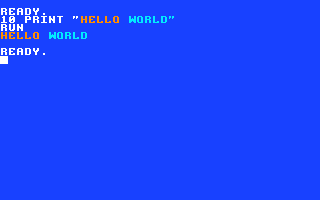

# The keyboard and the screen editor

Clementina's screen is also its editor. Whatever is on the screen can be
changed where it stands: move the cursor to any line, fix it, press RETURN,
and BASIC reads that line again as if you had just typed it. Commodore 64
owners will feel at home.

## Typing and moving around

| Key | What it does |
| --- | --- |
| Letters, numbers, symbols | Type at the cursor. |
| RETURN | Hand the line under the cursor to BASIC. |
| Cursor keys | Move the cursor anywhere on the screen, without changing anything. |
| HOME | Move the cursor to the top-left corner. |
| Backspace | Delete the character left of the cursor; the rest of the line closes up. |
| Delete | Delete the character under the cursor; the rest of the line closes up. |
| Insert (`Ctrl+I` in the video client) | Open a space at the cursor, to type something in the middle of a line. |
| `Ctrl+L` | Clear the screen and move the cursor home. |
| `Ctrl+C` | Stop a running program. |
| ESC | Start a style command (below). |

`CLS` in BASIC also clears the screen.

## Editing anywhere on the screen

Type a short program and list it:

```basic
10 PRINT "HELLO"
20 PRINT "WORLD"
LIST
```

Now move the cursor up onto line 20 with the cursor keys, move it over the
`W`, type `THERE` over `WORLD`, and press RETURN. `LIST` again: line 20 has
changed. You can even change the line number, and BASIC stores a copy of the
line under the new number.

When you press RETURN, the editor reads the **whole line under the cursor**,
wherever the cursor is in it. It skips spaces at the end of the line, and if
the line starts with a prompt that a program printed (such as `?` from
`INPUT`), it leaves the prompt out.

## Long lines

A line can be up to 80 characters, two rows of the screen. When you type
past the 40th column the line carries on in the next row, and the editor
remembers that the two rows are one **logical line**: pressing RETURN on
either row reads both. Keep lines within those two rows: BASIC reads at
most 80 characters of a line.

## Colors and styles: the ESC commands

Everything you type is drawn with the **pen**: a color, and whether the
characters are reversed or flipped. To change the pen, press ESC, let go,
then press one more key:

| Keys | What they do |
| --- | --- |
| ESC `0` … ESC `9`, ESC `A` … ESC `F` | Pick one of 16 colors (table below). |
| ESC `R` | Reverse on or off: the character's color and the background swap. |
| ESC `H` | Flip horizontally on or off (a mirror image). |
| ESC `V` | Flip vertically on or off (upside down). |
| ESC `M` | Change the glyph mode: 0, 1, 2, then back to 0. |
| ESC `P` | Paint mode (below). |
| ESC SPACE | Back to normal: white, not reversed or flipped, glyph mode 0. |

Any other key after ESC cancels it. Upper or lowercase doesn't matter.

The colors, as Clementina starts:

| Key | Color | Key | Color |
| --- | --- | --- | --- |
| `0` | white | `8` | magenta |
| `1` | red | `9` | black |
| `2` | orange | `A` | gray |
| `3` | yellow | `B` | light gray |
| `4` | green | `C` | brown |
| `5` | cyan | `D` | dark green |
| `6` | blue (the same as the background, so invisible) | `E` | light blue |
| `7` | violet | `F` | white |

The cursor shows the pen: it takes the pen's color and flip, and it changes
shape for reverse, for each glyph mode, while an ESC is waiting for its key,
and in Paint mode.

Colors stay with what you type. Type this program line, pressing ESC `2`
before `HELLO` and ESC `5` before `WORLD`, then run it:

```basic
10 PRINT "HELLO WORLD"
RUN
```



`RUN` prints `HELLO` in orange and `WORLD` in cyan, because the colors are
part of the text between the quotes. That is a **styled string**, and it
keeps its colors when you store it in a variable, cut it with `LEFT$` or
`MID$`, join it to another string, or save the program. Nothing extra is
added to the string: `LEN("HELLO")` is still 5.

## Paint mode: restyling without retyping

Paint mode changes the style of text that is already on the screen:

1. Set the pen you want with the ESC commands (for example ESC `3` for
   yellow).
2. Press ESC `P`. The cursor changes to the paint cursor.
3. Move with the cursor keys. Each SPACE paints the character under the
   cursor with the pen and moves right. The characters themselves don't
   change.
4. Press ESC to leave Paint mode, then RETURN on the line to store it.

## Graphics characters: the glyph modes

Clementina's character set has 256 characters: letters, numbers and
symbols, plus lines, blocks, card suits and other graphics.
[The character set](appendix/charset.md) shows them all.

The keyboard reaches them through three **glyph modes**. In mode 0, the
normal one, each key types its own character. ESC `M` steps to mode 1 and
then to mode 2, where each key types a graphics character instead; the
chart shows which. ESC `M` again (or ESC SPACE) goes back to mode 0. Between
the three modes you can type 254 of the 256 characters.

Graphics characters typed between quotes are kept like any other, so
`PRINT` draws them later. They are the quickest way to draw pictures and
borders on the text screen.

## Keys a program can read

`GET` and `INPUT` in a program receive the same characters the editor
does. [Key codes](appendix/keys.md) lists the code each key sends, for
programs that want to react to the cursor keys or RETURN.
