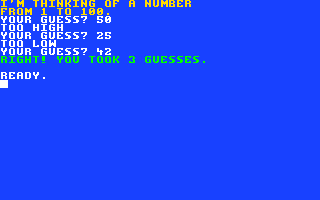
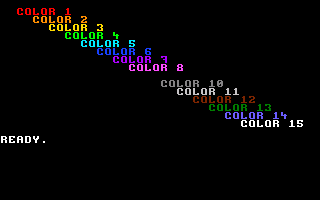

# Your first BASIC programs

BASIC is the language Clementina speaks when it says `READY.`. This chapter
teaches enough of it to write small programs and games. The
*Programmer's Reference Guide* has every keyword in full, and
[BASIC keywords](appendix/keywords.md) lists them all in one line each.

## PRINT: putting things on the screen

`PRINT` shows text and numbers. Text goes between quotes; numbers and sums
don't need them:

```basic
PRINT "CLEMENTINA"
PRINT 7*6
PRINT "7 TIMES 6 IS";7*6
```

```text
CLEMENTINA
 42
7 TIMES 6 IS 42
```

BASIC prints a space before a positive number, where a minus sign would go.
A semicolon between items prints them next to each other; a comma moves to
the next column of 14 characters. A semicolon at the very end keeps the
cursor on the same line for the next `PRINT`.

The arithmetic signs are `+`, `-`, `*` (times), `/` (divided by) and `^`
(to the power of). Parentheses work as in school: `PRINT (2+3)*4` prints
20.

A question mark is short for `PRINT`: `?7*6` does the same as `PRINT 7*6`.

## Variables: giving values a name

A variable holds a value under a name:

```basic
A=5
B=A*2
PRINT A,B
```

```text
 5             10
```

There are three kinds:

| Name | Holds | Example |
| --- | --- | --- |
| `SCORE` | a number, with decimals | `SCORE=12.5` |
| `LIVES%` | a whole number from -32768 to 32767 | `LIVES%=3` |
| `NAME$` | text, called a string, up to 255 characters | `NAME$="FRAN"` |

A name starts with a letter and may be long, but BASIC only looks at its
first two characters: `SCORE` and `SCREEN` are the same variable. A name
must not contain a BASIC keyword (`FORT` contains `FOR`), or BASIC reports
`?SYNTAX ERROR`.

## Programs

Lines with a number are stored as a program. Type these:

```basic
NEW
10 PRINT "WHAT IS YOUR NAME";
20 INPUT N$
30 PRINT "HELLO, ";N$;"!"
```

`NEW` erased any old program first. Now:

- `RUN` runs the program. `INPUT` shows a `?` and waits for you to type
  something and press RETURN.
- `LIST` shows the whole program. `LIST 20` shows line 20, and `LIST 10-20`
  lines 10 to 20.
- To change a line, type it again with the same number, or edit it on the
  screen (chapter 4).
- To delete a line, type its number alone and press RETURN.
- To add a line between two others, give it a number in between, such as
  `15`. That is why programs count in tens.

`INPUT` can show its own question: `20 INPUT "WHAT IS YOUR NAME";N$` does
lines 10 and 20 in one.

`REM` starts a remark: BASIC ignores the rest of the line, so you can leave
notes in your program.

## Making decisions: IF...THEN

`IF` tests a condition. When it is true, BASIC carries on with what follows
`THEN`; when it is false, it skips to the next line:

```basic
NEW
10 INPUT "HOW OLD ARE YOU";A
20 IF A<13 THEN PRINT "YOU ARE A KID"
30 IF A>=13 THEN PRINT "YOU ARE NOT A KID"
```

The comparisons are `=`, `<>` (not equal), `<`, `>`, `<=` and `>=`, and
`AND`, `OR` and `NOT` combine them. Strings compare too:
`IF N$="FRAN" THEN ...`.

## Repeating: FOR...NEXT and GOTO

`FOR` and `NEXT` repeat the lines between them, counting as they go:

```basic
NEW
10 FOR I=1 TO 5
20 PRINT I;"SQUARED IS";I*I
30 NEXT I
```

`STEP` changes how the count moves: `FOR I=10 TO 0 STEP -2` counts down in
twos.

`GOTO` jumps to another line. A program that jumps back to an earlier line
runs forever, until you press `Ctrl+C`:

```basic
NEW
10 PRINT "CLEMENTINA ";
20 GOTO 10
```

## Subroutines: GOSUB and RETURN

`GOSUB` jumps to a line like `GOTO`, but `RETURN` comes back to just after
the `GOSUB`. Use it for something the program does in several places:

```basic
NEW
10 PRINT "FIRST":GOSUB 100
20 PRINT "SECOND":GOSUB 100
30 END
100 PRINT "----------"
110 RETURN
```

A colon puts several statements on one line. `END` stops the program, so it
doesn't run into the subroutine by itself.

## A game: guess the number

This puts it all together. `RND(1)` gives a random number from 0 up to (not
including) 1, and `INT` drops the decimals, so line 50 picks a whole number
from 1 to 100. `RND(-TI)` first stirs the random numbers with the clock, so
each game is different. `STYLE 1` and `COLOR` print the game's messages in
color; the end of this chapter explains them.

```basic
NEW
10 REM GUESS THE NUMBER
20 CLS:STYLE 1:COLOR 3
30 PRINT "I'M THINKING OF A NUMBER"
40 PRINT "FROM 1 TO 100."
50 X=RND(-TI):N=INT(RND(1)*100)+1
60 T=0:COLOR 0
70 INPUT "YOUR GUESS";G
80 T=T+1
90 IF G<N THEN PRINT "TOO LOW":GOTO 70
100 IF G>N THEN PRINT "TOO HIGH":GOTO 70
110 COLOR 4:PRINT "RIGHT! YOU TOOK";T;"GUESSES."
120 COLOR 0:STYLE 0
```



## Colors and the screen from a program

| Statement | What it does |
| --- | --- |
| `CLS` | Clear the screen. |
| `COLOR n` | Print from now on in color `n`, 0 to 15 (the same colors as ESC `0` to ESC `F`). |
| `STYLE 1` | Make `PRINT` use the `COLOR` color for text between quotes too (see below). `STYLE 0` turns that off. |
| `BCOLOR n` | Change the screen's background to color `n`. `BCOLOR 6` is the usual blue. |
| `CRSR column,row` | Move the cursor: columns 0 to 39, rows 0 to 24, `0,0` at the top left. |

```basic
NEW
10 CLS:BCOLOR 9:STYLE 1
20 FOR C=1 TO 15
30 CRSR C*2,C:COLOR C:PRINT "COLOR";C
40 NEXT C
50 COLOR 0:STYLE 0
```



`COLOR 9` is missing from the picture because it is black on black.

Text you type between quotes keeps the color you typed it in, as chapter
4 showed, even in a program. So on its own, `COLOR` colors the numbers a
program prints and the strings it builds, while `"COLOR"` in line 30 would
stay white. `STYLE 1` tells `PRINT` to use the `COLOR` color for every
character, typed ones included; `STYLE 0`, the normal setting, lets each
string keep its own colors. The guessing game above uses `STYLE 1` the same
way.

`COLOR` and `STYLE` change what programs print, not what you type: your
typing keeps the pen you set with ESC. `BCOLOR 6`, `COLOR 0` and `STYLE 0`
put everything back.

## Saving your program

Programs in memory are lost when Clementina is switched off or reset. To
keep one, save it on the SD card:

```basic
SAVE "GUESS.BAS"
```

and bring it back later with `LOAD "GUESS.BAS"`. Chapter 9 has more.
