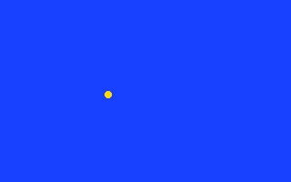
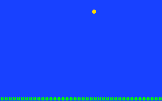
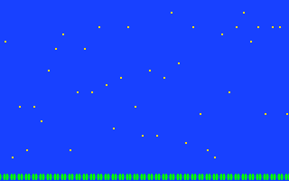

# Pictures and characters

So far everything has been text. Clementina's picture has more to it: under
the text there is a background that can scroll, and over the background up
to 256 sprites, small pictures that move on their own. This chapter draws
with all three from BASIC. The *Programmer's Reference Guide* covers every
graphics keyword, and the *SDK & Studio Guide* shows how to draw graphics
and maps in Clementina Studio instead of typing numbers.

## The layers

The picture is drawn in layers, from the back to the front:

1. **The backdrop**: one color behind everything. `BCOLOR` sets it.
2. **The background**: a grid of 8 × 8-pixel tiles, 40 across and 25 down
   on the screen, and up to four times bigger off the screen for scrolling.
3. **Sprites**: 8 × 8-pixel pictures, each placed anywhere by its own X and
   Y position.
4. **The text screen**: what `PRINT` writes and you type. It always stays
   on top.

At power-on only the text screen is switched on. The others are switched
on with `BGON` and `SPRON`, and off with `BGOFF` and `SPROFF`. `OVLOFF`
hides the text screen and `OVLON` shows it again.

Graphics stay on the screen after a program stops. To clear them, type
`SPROFF:BGOFF`, or press RESET.

## Tiles and colors

Everything on the screen, a letter or a sprite, is drawn from **tiles**:
8 × 8-pixel pictures stored in MIA's memory in eight **banks** of 256
tiles each. Bank 0 holds the character set, so tile 65 is the letter `A`;
the background can use it to draw with characters. Banks 2 to 7 start empty,
for your own tiles.

Each tile is drawn with one of the 16 **palettes**. In this chapter a palette
number works just like a `COLOR` number: palette 3 draws a one-color tile in
yellow, palette 4 in green, and so on (see
[Colors and the default palette](appendix/colors.md)). A tile can have up to
seven colors, but that needs more numbers than a beginner wants to type;
Clementina Studio draws such tiles for you.

## Drawing your own tile

A tile is eight rows of eight pixels, and each row is one number from 0 to
255. Add up the values of the pixels you want lit in that row:

| Pixel (left to right) | 1st | 2nd | 3rd | 4th | 5th | 6th | 7th | 8th |
| --- | --- | --- | --- | --- | --- | --- | --- | --- |
| Value | 1 | 2 | 4 | 8 | 16 | 32 | 64 | 128 |

The leftmost pixel is worth 1 and the rightmost 128, the opposite of the
Commodore 64. A ball:

```text
. . # # # # . .    4+8+16+32         = 60
. # # # # # # .    2+4+8+16+32+64    = 126
# # # # # # # #    all eight         = 255
# # # # # # # #                      = 255
# # # # # # # #                      = 255
# # # # # # # #                      = 255
. # # # # # # .                      = 126
. . # # # # . .                      = 60
```

`CHRREAD bank,offset,count` copies numbers from `DATA` lines into a tile
bank. Tile `n` starts at offset `n*8`, so this puts the ball in tile 1 of
bank 2:

```basic
CHRREAD 2,8,8
DATA 60,126,255,255,255,255,126,60
```

(Typed as program lines, as in the next example, because `DATA` only works
inside a program.)

## Your first sprite

```basic
NEW
10 CLS
20 CHRREAD 2,8,8
30 DATA 60,126,255,255,255,255,126,60
40 SPRBANK 2:SPRON
50 SPRITE 0,1,0,100,3,0
60 FOR X=0 TO 312
70 SPRX 0,X
80 NEXT X
90 GOTO 60
```



A yellow ball rolls across the screen, over and over, until you press
`Ctrl+C`. Line by line:

- **40** `SPRBANK 2` tells the sprites to take their tiles from bank 2, and
  `SPRON` switches the sprite layer on.
- **50** `SPRITE number,tile,x,y,palette,flags` sets up sprite 0: tile 1,
  at X 0 and Y 100, in palette 3 (yellow). The flags are 0 for a plain
  sprite; add 4 to mirror it left to right, 8 to turn it upside down, or 1
  to hide it.
- **60-80** `SPRX` moves sprite 0 to a new X without changing anything else.
  `SPRY` does the same for Y.

X runs from 0 at the left edge to 319 at the right, and Y from 0 at the top
to 199 at the bottom. A sprite can sit partly or completely off the screen
(X from -512 to 511, Y from -256 to 255), which is how things slide in from
an edge.

There are 256 sprites, numbered 0 to 255. When two overlap, the one with the
higher number is in front.

## A background

The background is made of cells, each holding a tile number and a palette.
`BGCHAR column,row,tile,palette` sets one cell. With `BGBANK 0` the
background draws from the character set, so tile 35 is `#`.

At power-on every background cell holds tile 0, which in the character set
is a small pattern of dots, so a program clears the background first. `MFILL` fills a stretch of MIA's memory with one value: line 20 fills
the background's 1000 tiles with spaces (32) and their palettes with 0.
(The addresses `$C200` and `$E140` are where the background lives in MIA's
memory; *Mapping Clementina* lists them.)

This program bounces the ball over a strip of green grass:

```basic
NEW
10 CLS:SPRON:SPRBANK 2
20 MFILL $C200,1000,32:MFILL $E140,1000,0
30 BGBANK 0:BGON
40 FOR C=0 TO 39:BGCHAR C,24,35,4:NEXT C
50 X=150:Y=20:DX=2:DY=1
60 SPRITE 0,1,X,Y,3,0
70 X=X+DX:Y=Y+DY
80 IF X<0 OR X>312 THEN DX=-DX:X=X+DX
90 IF Y<0 OR Y>184 THEN DY=-DY:Y=Y+DY
100 SPRX 0,X:SPRY 0,Y
110 GOTO 70
```

It uses the ball tile from the previous program, which stays in bank 2
until Clementina is reset. `DX` and `DY` are how far the ball moves each
step; when it reaches an edge, lines 80 and 90 turn it around.



## Scrolling

The background can be bigger than the screen. `BGMODE 1` makes it 80 cells
wide, twice the screen, and `SCROLL x,y` slides the screen's view across it
by pixels. When the view reaches the end it wraps around to the start, so a
scrolling landscape never runs out:

```basic
NEW
10 CLS:SPROFF:BGMODE 1:BGBANK 0:BGON
20 MFILL $C200,2000,32:MFILL $E140,2000,0
30 FOR C=0 TO 79
40 BGCHAR C,24,35,4
50 BGCHAR C,INT(RND(1)*22),46,3
60 NEXT C
70 FOR X=0 TO 639 STEP 2:SCROLL X,0:NEXT X
80 GOTO 70
```



Line 50 scatters yellow dots (tile 46, `.`) like stars, and line 70 scrolls
them past. The other modes make the background taller, or both wider and
taller:

| `BGMODE` | Background size, in cells |
| --- | --- |
| 0 | 40 × 25, the screen (no scrolling room) |
| 1 | 80 × 25 |
| 2 | 40 × 50 |
| 3 | 160 × 25 |
| 4 | 40 × 100 |
| 5 | 80 × 50 |

## Drawing with the text screen

The text screen alone can make pictures too. The graphics characters
(chapter 4, and [The character set](appendix/charset.md)) draw boxes, lines
and blocks; `CRSR` puts the cursor anywhere; and `COLOR` with `STYLE 1`
paints in any of the 16 colors. Because the text screen is on top, it is
also the place for a game's score.
