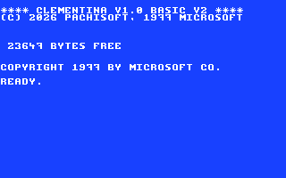

# Power on: the READY prompt

When Clementina starts, the screen turns blue and shows:



```text
**** CLEMENTINA V1.0 BASIC V2 ****
(C) 2026 PACHISOFT, 1977 MICROSOFT


 23647 BYTES FREE


COPYRIGHT 1977 BY MICROSOFT CO.

READY.
```

- The **banner** names the kernel and the BASIC. Clementina BASIC grew from
  the Microsoft BASIC that the Commodore 64 also used, which is why the
  copyright line is there.
- **23647 BYTES FREE** is the memory left for your BASIC program and its
  variables. Pictures and music are kept in MIA's own memory and don't use
  it.
- **READY.** means BASIC is waiting for you.

Below `READY.` is the **cursor**, a blinking square where the next
character you type appears. It blinks about every 0.4 seconds. The blink
follows the processor's clock, so if a program speeds the processor up, the
cursor blinks faster too.

The screen holds 40 columns and 25 rows of text, in white on a blue
background. Chapter 4 shows how to type in other colors.

## Two ways to use BASIC

Type this and press RETURN:

```basic
PRINT 2+3
```

BASIC answers at once:

```text
 5

READY.
```

That is **direct mode**: a line without a number runs as soon as you press
RETURN, like a calculator.

Now type a line that starts with a number:

```basic
10 PRINT "HELLO"
```

Nothing happens, and that's right. A line that starts with a number is a
**program line**: BASIC keeps it in memory for later. Type `RUN` to run the
program, and `LIST` to see it. Chapter 5 teaches programs properly.

You may type in lowercase: BASIC reads `print` the same as `PRINT`, and
`LIST` shows its keywords in capitals.

## Stopping and starting over

There are three ways to stop, from gentlest to strongest:

| | What it does | What you keep |
| --- | --- | --- |
| `Ctrl+C` | Stops a running BASIC program and prints `BREAK IN` and the line number. `CONT` carries on from there. | Everything |
| `NEW` | Erases the program in memory, ready for a new one. | Nothing in BASIC; your files on the SD card |
| RESET | Starts Clementina again from scratch, as when you switched it on. On the board it is the RESET button; in the emulator, the debugger's emulation menu (`E`). | Your files on the SD card. The program in memory is lost. |

Use RESET when the machine doesn't answer `Ctrl+C`, for example when a
machine-code program has taken over. Save your program first if you can
(chapter 9).
